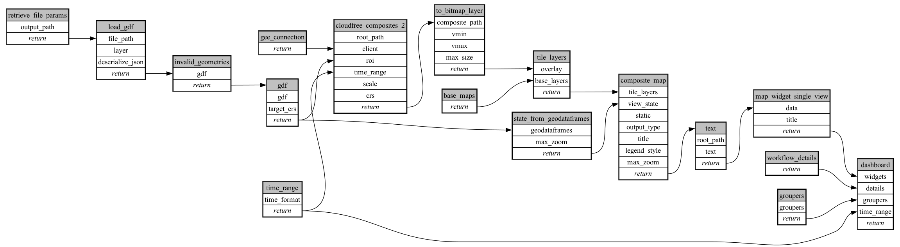

```
# AUTOGENERATED BY ECOSCOPE-WORKFLOWS; see fingerprint in README.md for details

```

```yaml
# fingerprint:
artifacts_sha256_basic: cbc1f881db528782100338fef0fce8f89c59d5fc13045ecfce9ba16daddf0fd9
artifacts_sha256_strict: 34554d285c06801e8ef3d793bc92290e6bf2cfbbfb66f55922cd215fd3f36948
installed_requirements:
- channel: https://repo.prefix.dev/ecoscope-workflows/
  name: ecoscope-platform
  version: {version: ==2.18.0}
- channel: https://repo.prefix.dev/ecoscope-workflows-custom/
  name: ecoscope-workflows-ext-custom
  version: {version: ==0.1.0rc14}
- channel: https://repo.prefix.dev/ecoscope-workflows-custom/
  name: ecoscope-workflows-ext-ste
  version: {version: ==0.0.0rc1}
- channel: https://repo.prefix.dev/ecoscope-workflows-custom/
  name: ecoscope-workflows-ext-mnc
  version: {version: ==1.0.5}
- channel: conda-forge
  name: pydeck
  version: {version: ==0.9.2}
- channel: https://repo.prefix.dev/ecoscope-workflows-custom/
  name: ecoscope-workflows-ext-mep
  version: {version: ==1.0.7}
params_sha256: 8705f2b48225d22393c28023bacd01b560f4c69b502aa793aad769541a7bd8d9
spec_sha256: 0175c6789e8e26d5126c7daf6a80a1e2f88e30ff2166375671b125c3b05193b7

```

# ecoscope-workflows-cloud-mask-composite-images-workflow


